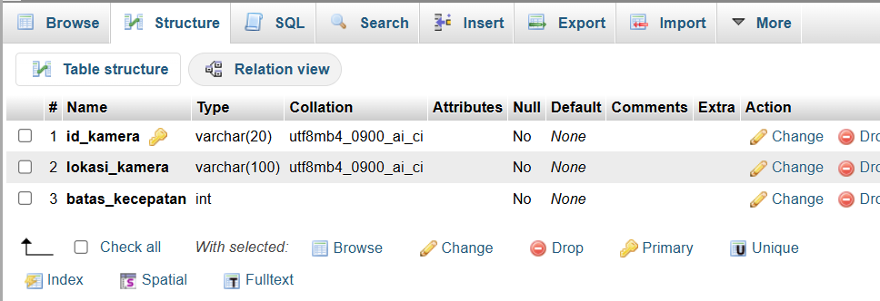
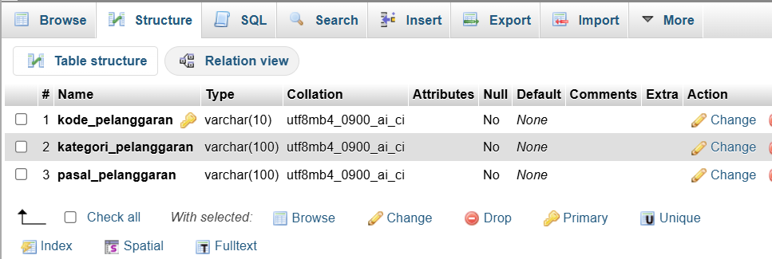
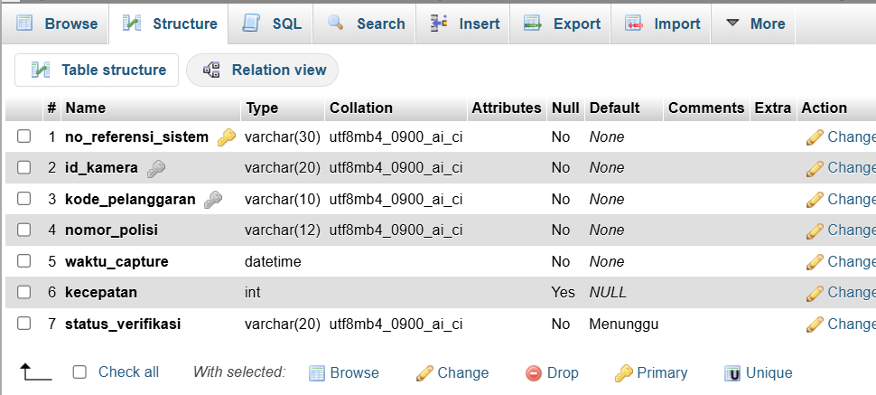
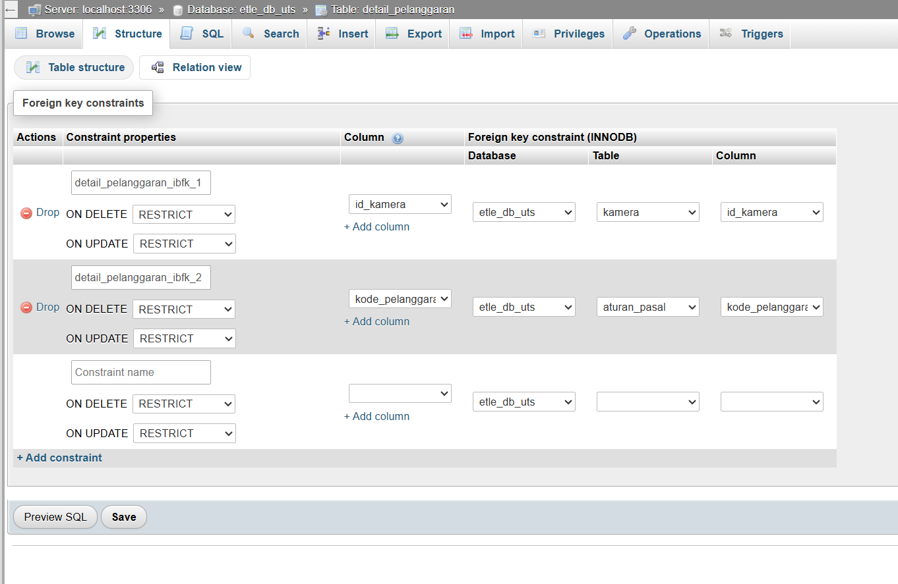
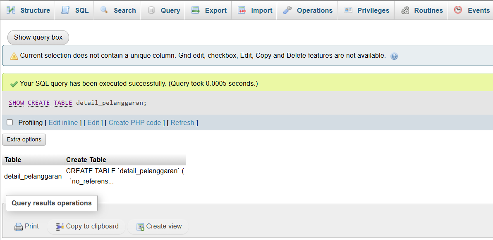

## Bukti Soal 1 (DDL & Relasi)

### 1. Struktur tabel kamera

### 2. Struktur tabel aturan_pasal

### 3. Struktur tabel detail_pelanggaran

### 4. Foreign Key (Relation view)

### 5. SHOW CREATE TABLE

