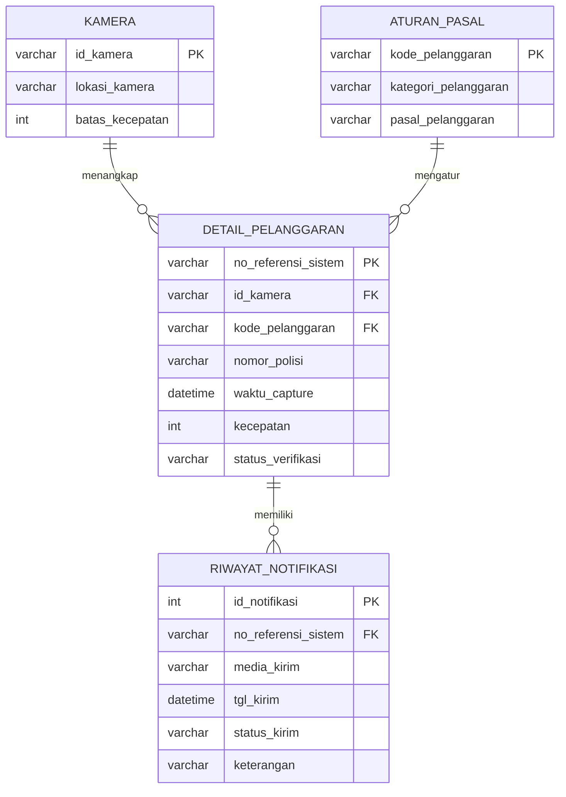

## Bukti Soal 1 (DDL & Relasi)

### 1. Struktur tabel kamera

### 2. Struktur tabel aturan_pasal

### 3. Struktur tabel detail_pelanggaran

### 4. Foreign Key (Relation view)

### 5. SHOW CREATE TABLE

## Bukti Soal 2 (CRUD)

### 1. CREATE - Insert 9 baris

### 2. READ - SELECT * FROM kamera

### 3. UPDATE - dengan WHERE Primary Key

### 4. DELETE - dengan WHERE

## Bukti Soal 3 (Query Kompleks & Agregasi)

### Data sumber

### Hasil query laporan

## Pemodelan Fisik: Implementasi Tabel riwayat_notifikasi (uts.sql)

### 1. Data tabel induk (detail_pelanggaran)

### 2. CREATE TABLE riwayat_notifikasi

### 3. INSERT data

### 4. Isi tabel

### 5. Struktur tabel (Primary Key)

### 6. Relasi (Foreign Key)

# UTS: Fitur Riwayat Notifikasi Tilang

## 1. Pemodelan Konseptual: ERD Fitur Riwayat Notifikasi Tilang

**Aturan bisnis:**
1. Satu pelanggaran dapat memiliki banyak notifikasi (pengiriman ulang jika gagal).
2. Satu notifikasi hanya milik satu pelanggaran.
3. Status notifikasi: Terkirim, Gagal, atau Diterima.
