## Bukti Soal 1 (DDL & Relasi)

### 1. Struktur tabel kamera

### 2. Struktur tabel aturan_pasal

### 3. Struktur tabel detail_pelanggaran

### 4. Foreign Key (Relation view)

### 5. SHOW CREATE TABLE

## Bukti Soal 2 (CRUD)

### 1. CREATE - Insert 9 baris
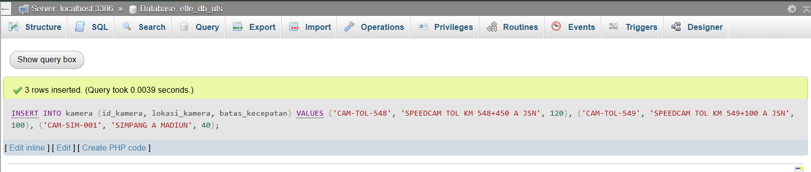
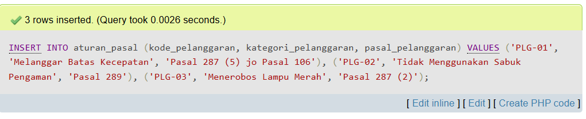
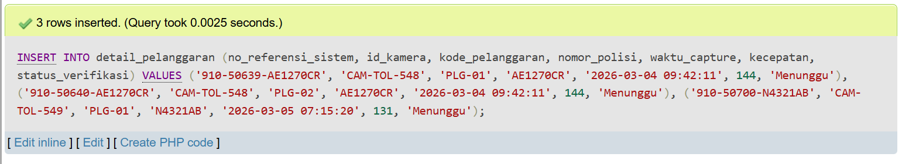

### 2. READ - SELECT * FROM kamera
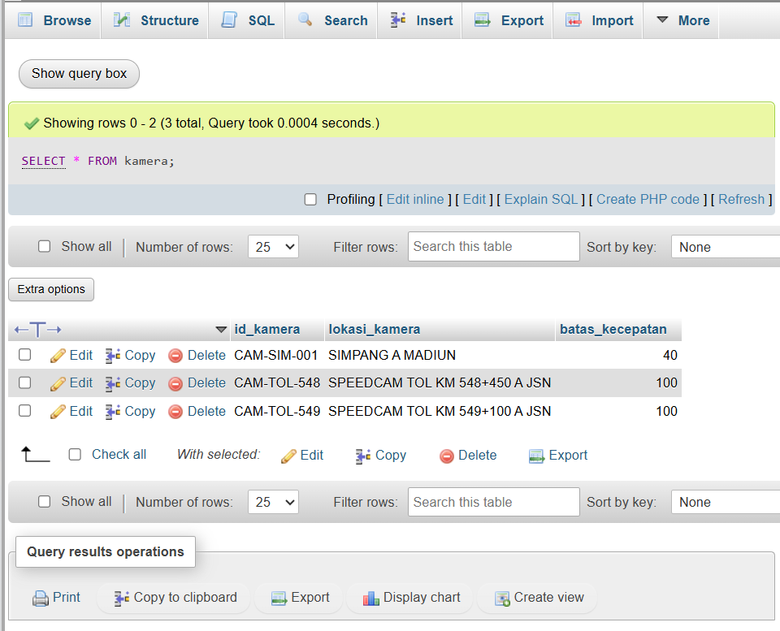

### 3. UPDATE - dengan WHERE Primary Key
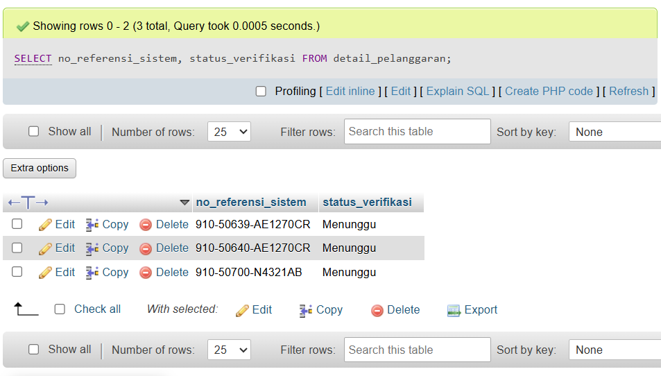
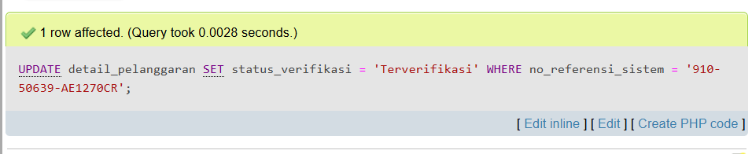
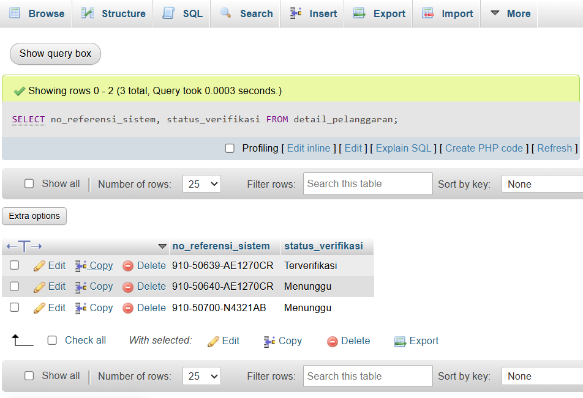

### 4. DELETE - dengan WHERE
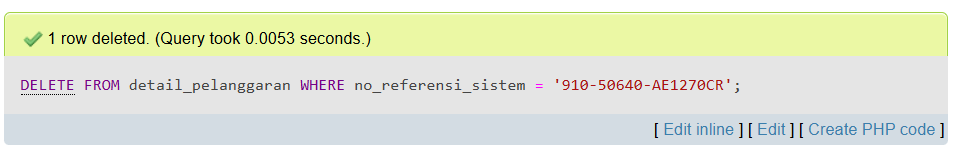
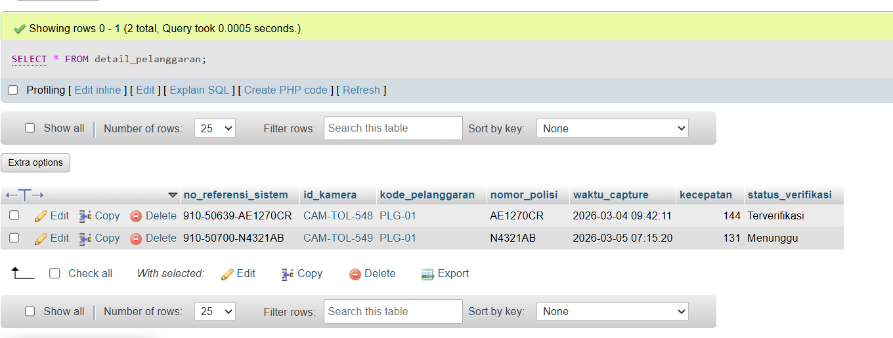

## Bukti Soal 3 (Query Kompleks & Agregasi)

### Data sumber
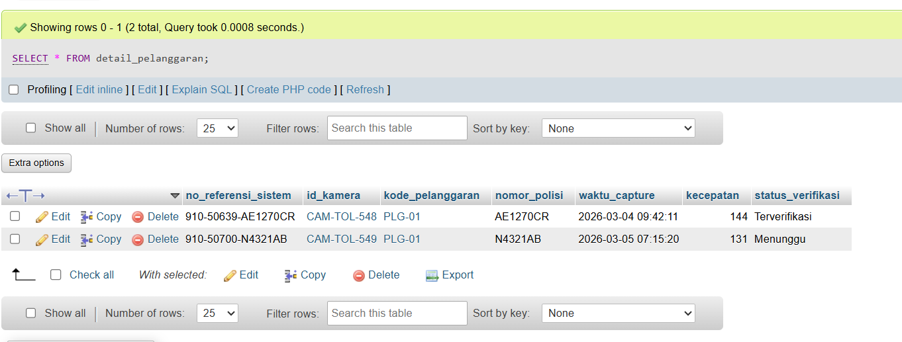

### Hasil query laporan
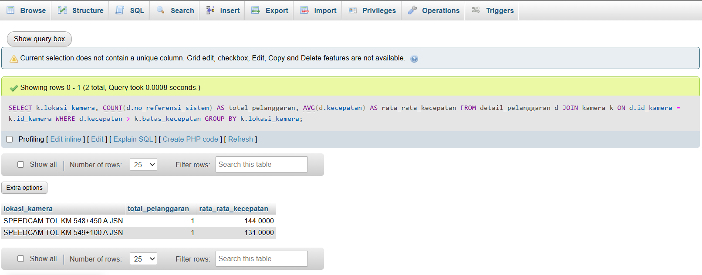
