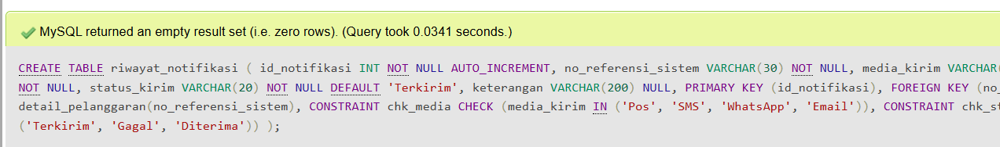
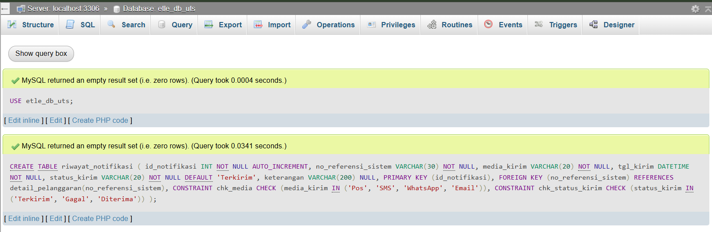
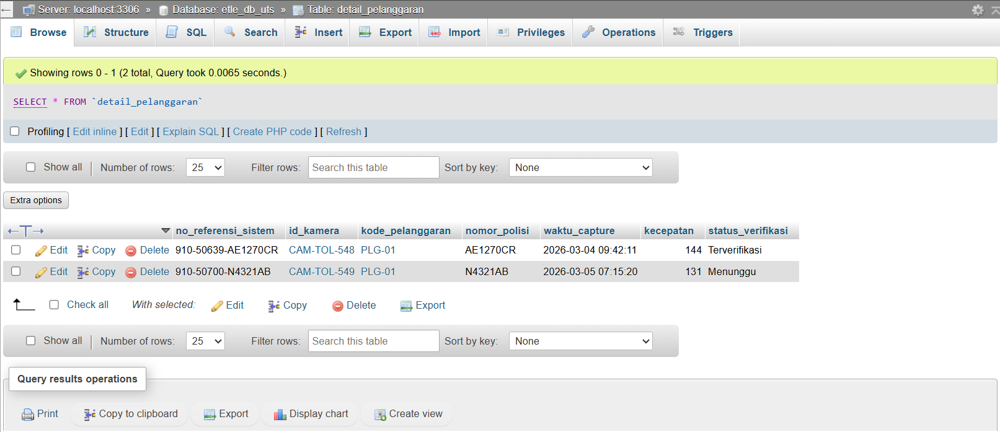
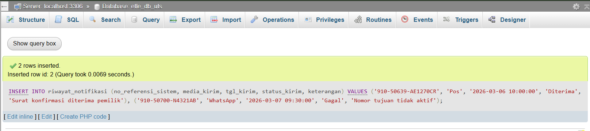
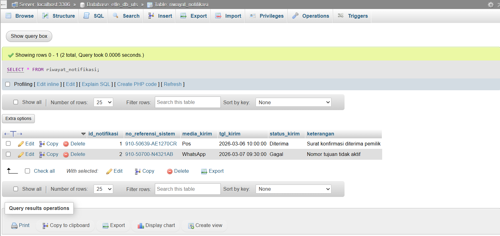
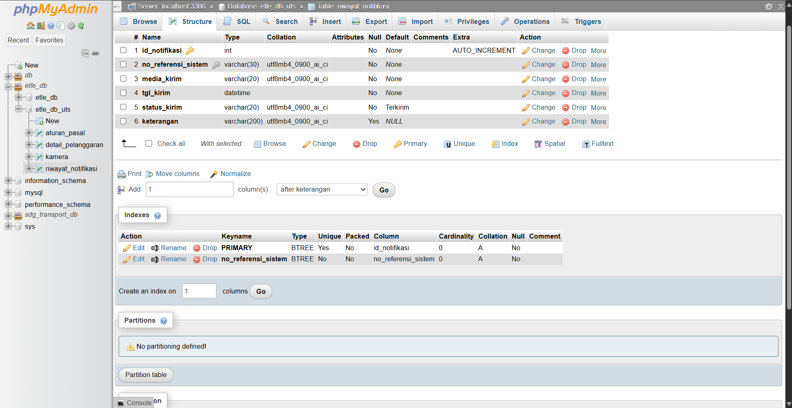
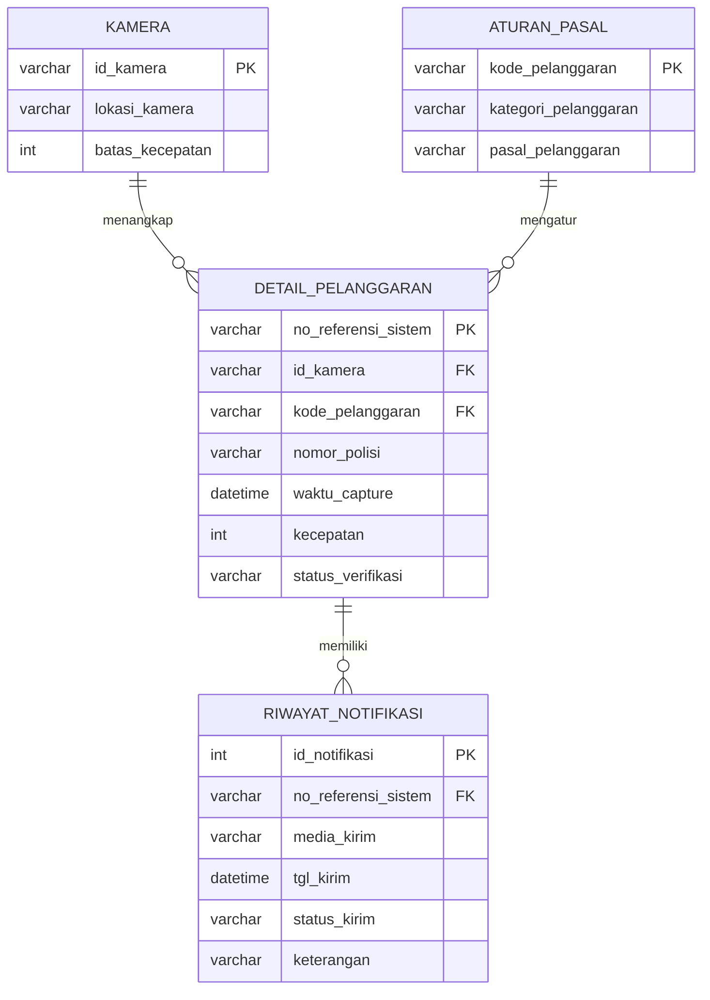

# UTS: Fitur Riwayat Notifikasi Tilang

---

## Pemodelan Fisik: Implementasi Tabel riwayat_notifikasi (uts.sql)

### 1. Data tabel induk (detail_pelanggaran)

### 2. CREATE TABLE riwayat_notifikasi

### 3. INSERT data

### 4. Isi tabel

### 5. Struktur tabel (Primary Key)

### 6. Relasi (Foreign Key)

# UTS: Fitur Riwayat Notifikasi Tilang

## 1. Pemodelan Konseptual: ERD Fitur Riwayat Notifikasi Tilang

**Aturan bisnis fitur Riwayat Notifikasi Tilang:**

1. Setelah pelanggaran direkam kamera dan diverifikasi petugas, pemilik kendaraan wajib diberi tahu lewat surat atau pesan.
2. Pemberitahuan bisa dikirim lebih dari sekali untuk satu pelanggaran. Contohnya pelanggaran `910-50700-N4321AB`: WhatsApp gagal terkirim karena nomor tidak aktif, sehingga bisa dikirim ulang lewat Pos.
3. Setiap pengiriman dicatat sendiri: lewat media apa (Pos, SMS, WhatsApp, atau Email), kapan dikirim, dan hasilnya (Terkirim, Gagal, atau Diterima).
4. Satu catatan notifikasi hanya untuk satu pelanggaran, jadi tidak ada catatan yang tidak jelas asalnya.
5. Riwayat disimpan dan tidak dihapus, supaya bisa menjadi bukti bahwa pemilik sudah diberi tahu.

## 2. Pemodelan Logis: Normalisasi UNF hingga 3NF

### UNF (Unnormalized Form)
Dokumen mentah "Log Pengiriman Notifikasi Tilang" memuat semua data dalam satu baris, dengan beberapa nilai dalam satu sel:

| no_referensi_sistem | nomor_polisi | kategori_pelanggaran | pasal | id_kamera | lokasi_kamera | media_kirim | tgl_kirim | status_kirim |
|---|---|---|---|---|---|---|---|---|
| 910-50639-AE1270CR | AE1270CR | Melanggar Batas Kecepatan | Pasal 287 (5) jo Pasal 106 | CAM-TOL-548 | SPEEDCAM TOL KM 548+450 A JSN | WhatsApp, Pos | 2026-03-05, 2026-03-06 | Gagal, Diterima |

### 1NF
Setiap sel hanya berisi satu nilai (atomik), satu baris per pengiriman:

| no_referensi_sistem | nomor_polisi | kategori_pelanggaran | pasal | id_kamera | lokasi_kamera | media_kirim | tgl_kirim | status_kirim |
|---|---|---|---|---|---|---|---|---|
| 910-50639-AE1270CR | AE1270CR | Melanggar Batas Kecepatan | Pasal 287 (5) jo Pasal 106 | CAM-TOL-548 | SPEEDCAM TOL KM 548+450 A JSN | WhatsApp | 2026-03-05 | Gagal |
| 910-50639-AE1270CR | AE1270CR | Melanggar Batas Kecepatan | Pasal 287 (5) jo Pasal 106 | CAM-TOL-548 | SPEEDCAM TOL KM 548+450 A JSN | Pos | 2026-03-06 | Diterima |

Kandidat Primary Key: (no_referensi_sistem, media_kirim, tgl_kirim).

### 2NF
Ketergantungan parsial: nomor_polisi, kategori_pelanggaran, pasal, id_kamera, dan lokasi_kamera hanya bergantung pada `no_referensi_sistem` (sebagian dari PK). Tabel dipecah:
- `detail_pelanggaran` (PK: no_referensi_sistem)
- `riwayat_notifikasi` (PK: id_notifikasi, FK: no_referensi_sistem)

### 3NF
Ketergantungan transitif dipisah:
- no_referensi_sistem → id_kamera → lokasi_kamera, batas_kecepatan, sehingga dibentuk tabel `kamera`
- no_referensi_sistem → kode_pelanggaran → kategori_pelanggaran, pasal, sehingga dibentuk tabel `aturan_pasal`

### Hasil akhir 3NF
| Tabel | Primary Key | Foreign Key |
|---|---|---|
| kamera | id_kamera | - |
| aturan_pasal | kode_pelanggaran | - |
| detail_pelanggaran | no_referensi_sistem | id_kamera, kode_pelanggaran |
| riwayat_notifikasi | id_notifikasi | no_referensi_sistem |
